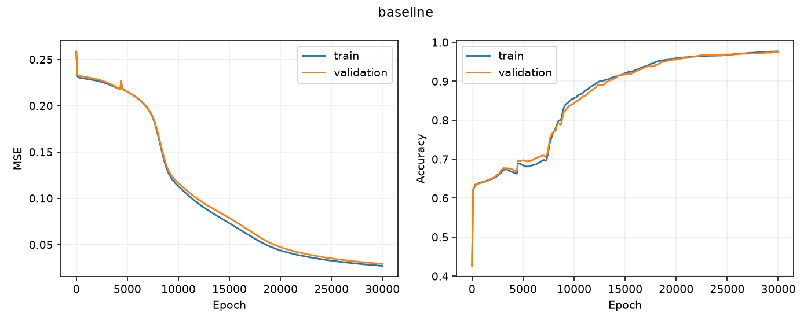

# Mini-Sofi 1.0

Progetto locale derivato dagli allegati `mini_sofi_07.py` e `mondo.csv`.
Gli originali sono copiati byte per byte in `originals/`: il programma non li modifica e non esegue lo script originale. `originals/SHA256.json` permette di controllarne l'integrità.

## Ambiente riproducibile

Ambiente verificato: Python 3.14.8, NumPy 2.5.3, Matplotlib 3.11.2, Windows. Le dipendenze dirette sono fissate in `requirements.txt`; per riproduzioni numeriche strette usare la stessa versione Python, sistema e librerie BLAS. Il seed non garantisce identità bit per bit fra piattaforme diverse.

Da PowerShell, nella cartella del progetto:

```powershell
python -m venv .venv
.\.venv\Scripts\python.exe -m pip install -r requirements.txt
$env:OPENBLAS_NUM_THREADS = '1'
$env:OMP_NUM_THREADS = '1'
$env:MKL_NUM_THREADS = '1'
.\.venv\Scripts\python.exe -m unittest discover -s tests -v
.\.venv\Scripts\python.exe mini_sofi.py --out runs/baseline_20 --epochs 20 --seed 42
.\.venv\Scripts\python.exe mini_sofi.py --mode experiment --out runs/experiment_20 --epochs 20 --seed 42
```

Ogni cartella di destinazione deve essere nuova per evitare sovrascritture. Il default è 20 epoche; l'interfaccia richiede `--allow-long-run` oltre 500 epoche. Non c'è un lancio automatico di 30.000 epoche: un addestramento lungo richiede prima conferma dell'utente e revisione esplicita del limite/configurazione. Non aggirare il limite concatenando esecuzioni.

## Dati effettivamente verificati

Il file contiene **10.000 righe di dati**, oltre all'intestazione, e **3 colonne**, `x1,x2,risposta`. Ogni riga ha tre campi. Non ci sono valori mancanti, non finiti, righe duplicate o coppie di input ripetute. Le classi sono 0 (4.245 esempi) e 1 (5.755 esempi).

| Colonna | Minimo | Massimo |
|---|---:|---:|
| x1 | 0.0000368198018453 | 0.9999664389651097 |
| x2 | 0.0000184556844108 | 0.9998254744346327 |
| risposta | 0 | 1 |

Il caricatore verifica intestazione, numero di colonne, valori finiti, target binario e unicità degli input. Dati con input ripetuti sono rifiutati: richiederebbero un criterio di suddivisione per gruppi, evitando contaminazione tra insiemi.

Split stratificato, deterministico, con seed 42: **6.999 train, 1.500 validation, 1.501 test**. Le soglie 70% e 85% sono arrotondate per difetto all'interno di ciascuna classe; questo spiega lo scarto rispetto a 7.000/1.500/1.500. I conteggi sono calcolati, non inseriti come assunzione. Tutti i modelli di uno stesso esperimento ricevono esattamente gli stessi indici. Gli indici sono salvati in `splits.npz` e si riferiscono alle righe di dati nell'ordine originale, con indice iniziale zero.

Nessuna normalizzazione: gli input effettivi sono già nell'intervallo [0,1], come previsto dallo script originale. Non si stimano trasformazioni sul test. La selezione del checkpoint usa esclusivamente la MSE di validation; il test viene misurato una sola volta per modello dopo la selezione. La separazione casuale non certifica indipendenza rispetto a eventuali gruppi o dipendenze ignote del generatore del CSV.

## Modello di riferimento

Architettura originale **2 → 64 → 64 → 32 → 1**, 6.465 parametri, sigmoid in tutti gli strati, pesi uniformi [-1,1], bias nulli e discesa del gradiente full batch. La loss resta la MSE. Nella versione originale il gradiente omette il fattore 2 della MSE; qui il gradiente è esatto e il learning rate predefinito è **0,4**, equivalente al fattore di aggiornamento originale 0,8. La riproduzione non è una copia identica dell'esecuzione 0.7: cambia la suddivisione stratificata, viene fissato il seed, si seleziona il checkpoint su validation e si eseguono esattamente N aggiornamenti, oltre alla misura iniziale all'epoca zero.

## Risultati e checkpoint

Ogni run produce:

- `dataset_report.json`: struttura, distribuzione, intervalli e SHA-256 del CSV.
- `config.json`: argomenti, versioni, piattaforma e conteggi effettivi degli split.
- `splits.npz`: indici train/validation/test.
- `<modello>_best.npz` e `<modello>_last.npz`: pesi, tipo di rete, epoca, seed e hash dei dati.
- `<modello>_history.csv`: loss e accuracy train/validation a ogni intervallo di valutazione.
- `<modello>_curves.png`: curve di loss e accuracy.
- `metrics.json`: MSE, accuracy, precision, recall, F1, balanced accuracy e matrice di confusione per ogni insieme, sul checkpoint selezionato.

La soglia è fissata a 0,5. La classe positiva è 1. Le matrici sono `[[TN, FP], [FN, TP]]`; precision/recall/F1 con denominatore nullo valgono zero. Nessuna metrica test viene usata per scegliere architettura, soglia o durata.

Caricare e usare un checkpoint, dalla cartella del progetto:

```python
import numpy as np
from mini_sofi import Network
model, metadata = Network.load('runs/baseline_smoke/baseline_best.npz')
probabilita = model.forward(np.array([[0.2, 0.8]], dtype=float))
risposta = (probabilita >= 0.5).astype(int)
print(metadata, probabilita, risposta)
```

Si tratta di inferenza, non di ripresa completa dell'addestramento. Il trainer non implementa il resume; una nuova esecuzione parte dal seed dichiarato.

## Esperimento con due reti

Vedi `EXPERIMENT.md` per il protocollo e i limiti dei controlli. `--mode experiment` esegue comunicante, isolato e monolitico con budget, loss e split comuni. La modalità baseline mantiene separato il riferimento originale più grande.

## Verifiche già eseguite

Cinque test automatici passati: integrità degli originali, split completi/disgiunti/ripetibili, gradienti numerici per tutte le architetture, salvataggio/caricamento e aggiornamenti deterministici, dipendenza tra reti presente con messaggi e assente nel controllo isolato.

In `runs/` sono incluse prove di **5 epoche** per il riferimento e per i tre controlli. Sono verifiche di funzionamento, non risultati scientifici di convergenza. La baseline raggiunge accuracy test 0,575616 ma balanced accuracy 0,5: predice solo 1. Comunicante e isolato predicono solo 0 in questa prova. Non c'è evidenza di un beneficio della comunicazione da queste esecuzioni brevi.

## Addestramento lungo autorizzato il 19 ottobre 2026

Dopo la conferma dell'utente è stato avviato il riferimento originale per 30.000 epoche, seed 42, learning rate 0,4, full batch e un thread BLAS. Il confronto tra reti comunicanti resta una fase separata. La pubblicazione su GitHub è stata successivamente autorizzata.

```powershell
python mini_sofi.py --epochs 30000 --allow-long-run --eval-every 100 --seed 42 --out runs/baseline_30000_seed42
```

La validation viene misurata ogni 100 epoche, oltre all'epoca zero e finale. Il checkpoint migliore è scelto tra queste misure. `progress.json` indica stato, epoca e loss; `baseline_history.csv` viene aggiornato durante il training. `baseline_latest.npz` conserva un checkpoint ogni 1.000 epoche e all'ultima. `baseline_last.npz`, metriche finali e curve vengono prodotti al completamento. Il test non è consultato durante il training. La configurazione registra hash del codice e ambiente dei thread. Non è implementata la ripresa automatica da checkpoint.

## Risultato completato: 30.000 epoche

La rete di riferimento ha completato il training il 19 ottobre 2026. Il checkpoint selezionato tramite MSE validation è all'epoca 30.000.

| Metrica | Validation | Test |
|---|---:|---:|
| Accuracy | 97,40% | 97,53% |
| Balanced accuracy | 97,33% | 97,34% |
| F1 | 97,74% | 97,87% |
| MSE | 0,029140 | 0,027601 |

Test: 1.501 esempi, 1.464 corretti, 25 falsi positivi e 12 falsi negativi. Singola esecuzione con seed 42: non dimostra un vantaggio della comunicazione. I tre modelli del confronto hanno eseguito solo le prove brevi di cinque epoche.



[Metriche complete](runs/baseline_30000_seed42/metrics.json) · [Pesi migliori](runs/baseline_30000_seed42/baseline_best.npz) · [Cronologia](runs/baseline_30000_seed42/baseline_history.csv)
